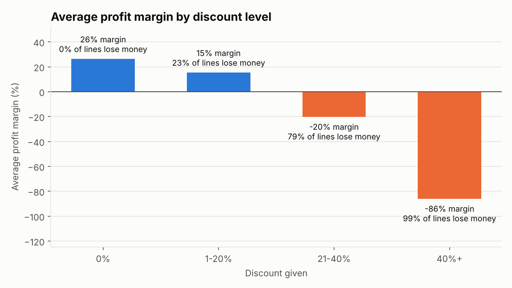
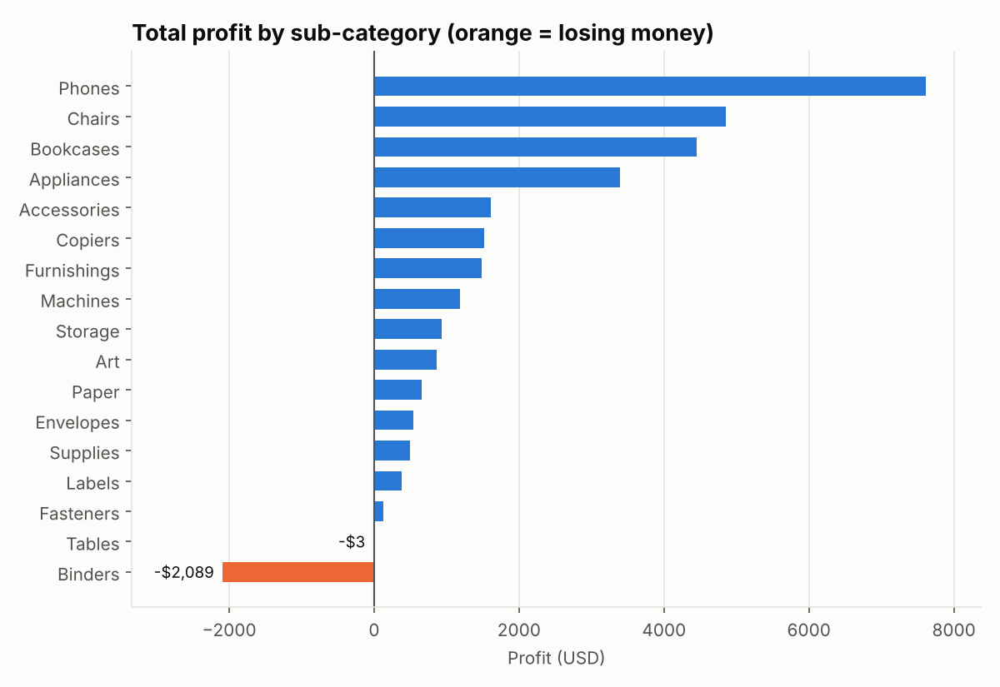
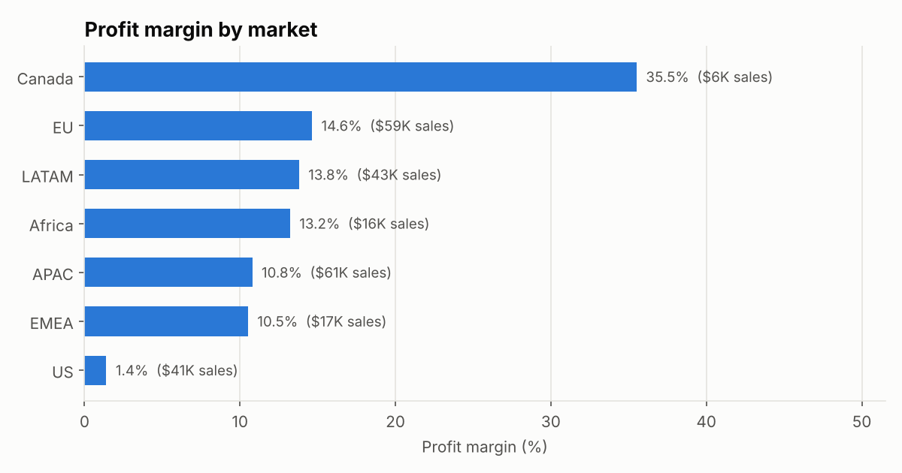
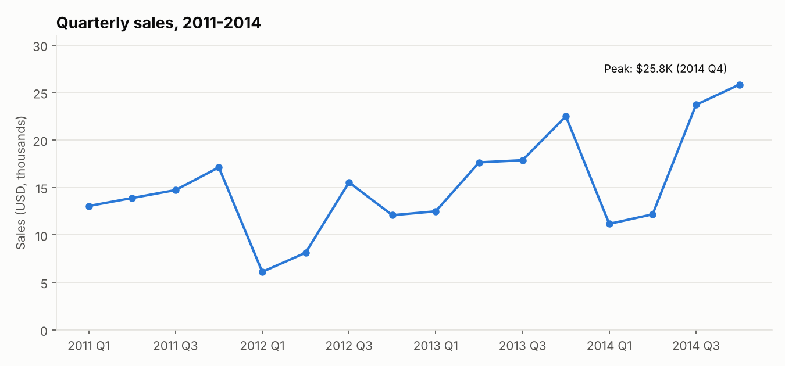

# Global Superstore — Sales & Profitability Analysis

An end-to-end data analytics project: raw retail order data is **cleaned with Python**, **loaded into a SQLite database**, **analyzed with SQL**, and turned into **charts and business recommendations**.

**Tools:** Python (pandas, matplotlib) · SQL (SQLite, CTEs, window functions) · Git

---

## Business questions

1. Which markets are most and least profitable?
2. Which product sub-categories lose money, and why?
3. How do discounts affect profitability?
4. How have sales changed over time?
5. Who are the most valuable customers?
6. How long does shipping take for each ship mode and priority?

## Key findings

| Metric | Value |
|---|---|
| Order lines analyzed | 1,000 |
| Orders / customers | 979 / 654 |
| Total sales | $243,960 |
| Total profit | $28,009 |
| Overall profit margin | 11.5% |

**1. Discounts above 20% destroy profit.** Lines with no discount earn a 26% average margin and never lose money. At 21–40% off, the average margin falls to −20% and 79% of lines lose money. Above 40% off, the average margin is −86% and almost every line (99%) is a loss.



**2. Binders are the one big money-loser.** Binders lost $2,089 on $13,946 of sales, while every other sub-category except Tables made money. Phones are the top earner ($7,616 profit).



**3. The US market barely breaks even.** The US brings in $41K of sales but only a 1.4% margin, compared with 10–15% in most other markets. Binders alone lost $3,025 in the US, which is more than five times the US market's total profit ($571). Canada shows the highest margin (35.5%), but it has only 6 order lines and gave no discounts, so that number isn't reliable.



**4. Sales trend upward, with strong second halves.** Yearly sales went from $58.8K (2011) to $72.9K (2014), and the best quarter was 2014 Q4 ($25.8K). Sales dipped in 2012 (−28.8%) before recovering (+68.5% in 2013).



## Recommendations

- **Cap discounts at 20%** unless a promotion is planned to clear stock. That's the point where most order lines start losing money.
- **Review binder pricing and discounting in the US.** Fixing this one product line in one market would lift US profit several times over.
- **Plan inventory and staffing for a busier second half of the year**, when sales are consistently higher.

## Project structure

```
superstore-sales-analysis/
├── data/
│   ├── raw/                      # original export (untouched)
│   └── processed/                # cleaned CSV produced by clean_data.py
├── sql/
│   ├── schema.sql                # table definition + indexes
│   └── analysis_queries.sql      # 7 business questions in SQL
├── src/
│   ├── clean_data.py             # step 1: clean & validate
│   ├── load_to_sqlite.py         # step 2: load into SQLite
│   └── analysis.py               # step 3: build charts from the database
├── images/                       # charts used in this README
├── run_pipeline.py               # runs all three steps
└── requirements.txt
```

## Data cleaning

The raw file had several real-world problems, all fixed in `src/clean_data.py`:

- European decimal commas in numbers (`45,06` → `45.06`)
- Dates stored as text (`8/15/14` → `2014-08-15`)
- Postal codes stored as floats (`27217.0` → `27217`) and blank outside the US
- A leftover unnamed index column and inconsistent column names

The script also adds useful columns (`days_to_ship`, `profit_margin`, `is_loss`, `order_year`, `order_month`) and runs validation checks, such as unique row IDs, positive sales and ship dates on or after order dates, before saving.

## SQL highlights

`sql/analysis_queries.sql` uses aggregation, `CASE` bucketing, CTEs and window functions. For example, year-over-year growth with `LAG()`:

```sql
WITH yearly AS (
    SELECT order_year, SUM(sales) AS sales
    FROM orders
    GROUP BY order_year
)
SELECT
    order_year,
    ROUND(sales, 2) AS sales,
    ROUND(100.0 * (sales - LAG(sales) OVER (ORDER BY order_year))
          / LAG(sales) OVER (ORDER BY order_year), 1) AS yoy_growth_pct
FROM yearly;
```

## How to run it

```bash
git clone https://github.com/<your-username>/superstore-sales-analysis.git
cd superstore-sales-analysis
pip install -r requirements.txt
python run_pipeline.py
```

This rebuilds the cleaned CSV, the SQLite database (`data/superstore.db`) and every chart. To run the SQL yourself, open `data/superstore.db` in [DB Browser for SQLite](https://sqlitebrowser.org/) or the VS Code SQLite extension, then run the queries in `sql/analysis_queries.sql`.

## About the data

A 1,000-row sample of the Global Superstore orders dataset (2011–2014), taken from the public [plotly/datasets](https://github.com/plotly/datasets) repository. It is a sample, not the full dataset, so small markets (such as Canada) and year-to-year swings should be read with caution.
